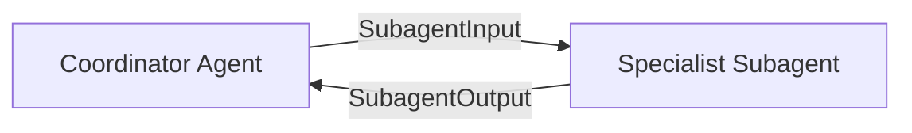

# Subagent Protocol: 主协调者与领域子 Agent 通信规约

**Branch**: `006-unified-coordinator-agent` | **Date**: 2026-11-11

---

## 1. 协议概览

主协调者（Coordinator）与各领域专业子 Agent（Specialist Subagents）在系统内部通过纯 TypeScript 接口调用，遵循统一的 **Task Dispatch & Turn Execution 协议**。



---

## 2. 输入规约 (`SubagentInput`)

子 Agent 执行单个交互轮次时，接收结构化的专业输入上下文：

```ts
export type SubagentInput = {
  taskId: string;
  conversationId: string;
  subagentType: "image" | "icon" | "svg";
  
  // 核心诉求描述（来自 Coordinator 的提炼或用户本轮答复）
  userPrompt: string;
  
  // 继承自前序会话的风格与世界观上下文（例如配色、角色特征）
  contextSummary?: string;
  
  // 该任务内专属的历史问答对（不包含外部无关闲聊）
  taskHistory: Array<{ role: "user" | "assistant"; content: string }>;
  
  // 语言环境
  locale: "zh" | "en";
  
  // 用户是否要求立即生成
  forceSkip: boolean;
};
```

---

## 3. 输出规约 (`SubagentOutput`)

子 Agent 完成内部推导后，返回结构化的响应数据：

```ts
export type SubagentOutput = {
  // 领域专家向用户回复的自然语言说明（如为什么提这些问题，或建议的方案）
  assistantMessage: string;
  
  // 待澄清的专业技术要点（0~4 个）
  clarifyingQuestions: string[];
  
  // 推荐的结构化 Prompt
  suggestedPrompt: string;
  
  // 图标专用推荐尺寸（例如 [16, 32, 64]）
  suggestedSizes?: number[];
  
  // 当前信息是否已经完备，可以触发生成
  readyToGenerate: boolean;
  
  // 若提前生成，依据的专业假设
  assumptions: string[];
};
```

---

## 4. 各专业子 Agent 的特定职责

| 专业子 Agent | 专注于 | 关键质量考核项 |
| --- | --- | --- |
| **ImageSpecialist** | 场景插画、角色立绘、游戏背景 | 构图、画风修饰词（如 Octane render, 8k, cel shading）、否定词 |
| **IconSpecialist** | 游戏道具、应用图标、像素图标 | 像素边长列表（`suggestedSizes`）、透明通道 Alpha、边缘抗锯齿与边界清晰度 |
| **SvgSpecialist** | 矢量 UI 图标、单色图标 | 必须使用 `currentColor`、必须含合法 `viewBox`、适合 CSS 动态控制 |

