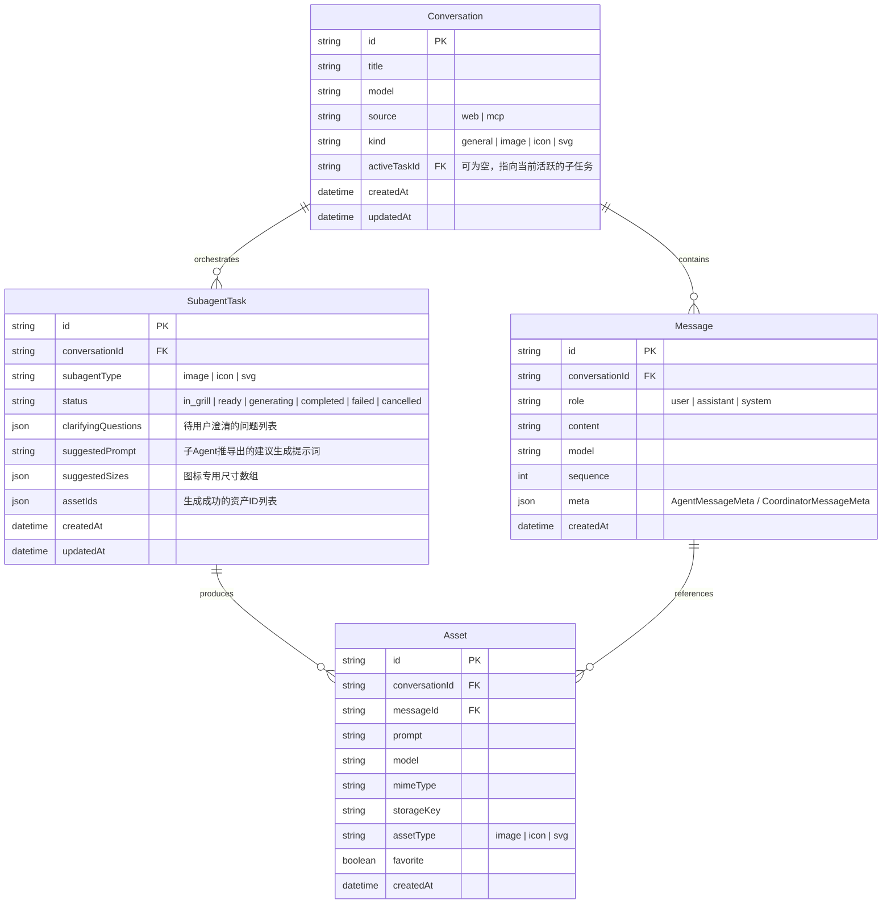

# Data Model: 统一主聊天 Agent 与子 Agent 任务协同架构

**Branch**: `006-unified-coordinator-agent` | **Date**: 2026-11-11

---

## 1. 实体关系总览 (ER Diagram)



---

## 2. 核心数据表与类型定义

### 2.1 会话类型扩展 (`ConversationKind`)
```ts
// lib/db/types.ts
export type ConversationKind = "general" | "image" | "icon" | "svg";

export type Conversation = {
  id: string;
  title: string | null;
  model: string;
  source: ConversationSource;
  kind: ConversationKind;
  activeTaskId?: string | null; // 新增：当前挂起/进行中的任务ID
  createdAt: string;
  updatedAt: string;
};
```

### 2.2 子任务模型 (`SubagentTask`)
```ts
// lib/db/types.ts
export type SubagentType = "image" | "icon" | "svg";

export type SubagentTaskStatus =
  | "in_grill"     // 正在反问澄清中，等待用户提供参数
  | "ready"        // 参数齐备，就绪生成
  | "generating"   // 正在调用底层生图引擎
  | "completed"    // 生成完成，已落盘入库
  | "failed"       // 上游失败或校验未通过
  | "cancelled";   // 用户取消或切换话题

export type SubagentTask = {
  id: string;
  conversationId: string;
  subagentType: SubagentType;
  status: SubagentTaskStatus;
  clarifyingQuestions: string[];
  suggestedPrompt: string;
  suggestedSizes?: number[];
  assetIds?: string[];
  errorMessage?: string | null;
  createdAt: string;
  updatedAt: string;
};
```

### 2.3 消息元数据扩展 (`MessageMeta`)
```ts
// lib/agents/types.ts

// 主协调者 Agent 回复的元数据
export type CoordinatorMessageMeta = {
  kind: "coordinator_reply";
  intent: "chat" | "delegate" | "task_update";
  subagentType?: SubagentType;
  taskId?: string;
  taskStatus?: SubagentTaskStatus;
  clarifyingQuestions?: string[];
  suggestedPrompt?: string;
  suggestedSizes?: number[];
  readyToGenerate?: boolean;
  agentModel?: string;
};

// 保持对旧版本 AgentMessageMeta 的兼容
export type AgentMessageMeta = {
  kind: "agent_reply";
  assistantMessage: string;
  clarifyingQuestions: string[];
  suggestedPrompt: string;
  suggestedSizes: number[];
  readyToGenerate: boolean;
  assumptions: string[];
  agentModel?: string;
};

export type MessageMeta =
  | CoordinatorMessageMeta
  | AgentMessageMeta
  | UserMessageMeta
  | ImageResultMeta;
```

---

## 3. SQLite DDL 变更设计

### 3.1 增加 `subagent_tasks` 表
```sql
CREATE TABLE IF NOT EXISTS subagent_tasks (
  id TEXT PRIMARY KEY,
  conversation_id TEXT NOT NULL,
  subagent_type TEXT NOT NULL,
  status TEXT NOT NULL,
  clarifying_questions TEXT NOT NULL DEFAULT '[]',
  suggested_prompt TEXT NOT NULL DEFAULT '',
  suggested_sizes TEXT NOT NULL DEFAULT '[]',
  asset_ids TEXT NOT NULL DEFAULT '[]',
  error_message TEXT,
  created_at TEXT NOT NULL,
  updated_at TEXT NOT NULL,
  FOREIGN KEY (conversation_id) REFERENCES conversations(id) ON DELETE CASCADE
);

CREATE INDEX IF NOT EXISTS idx_tasks_conversation_id ON subagent_tasks(conversation_id);
CREATE INDEX IF NOT EXISTS idx_tasks_status ON subagent_tasks(status);
```

### 3.2 变更 `conversations` 表（轻量新增列）
```sql
-- 支持活跃任务指向
ALTER TABLE conversations ADD COLUMN active_task_id TEXT;
```

---

## 4. 数据完整性与生命周期规则

1. **会话创建**：
   - 用户未显式指定 `kind` 时，默认设为 `"general"`。
2. **任务创建与流转**：
   - 当 Coordinator 识别出生图/图标意图时，新建一条 `SubagentTask`（状态 `in_grill` 或 `ready`），并将 `conversation.active_task_id` 指向该任务。
3. **任务结束清空指针**：
   - 任务流转至 `completed`、`cancelled` 或 `failed` 后，`active_task_id` 自动置为 `null`，会话恢复为随时接收全新任务的状态。
4. **级联清理**：
   - 删除会话时，其下的 `subagent_tasks` 自动级联删除。

