# Research & Architecture Decisions: 统一主聊天 Agent 与子 Agent 任务协同架构

**Branch**: `006-unified-coordinator-agent` | **Date**: 2026-11-11

---

## 1. Coordinator 意图识别与调度机制选型

### 问题
主 Agent 需要识别用户意图是“普通闲聊”、“文生图”、“位图图标”、“SVG 矢量”还是“任务取消/跳过”，应采用 Function Calling 还是结构化 JSON 提示词？

### 调研与比对
- **方案 A：原生 Function Calling / Tool Calling**
  - *优点*：协议标准化。
  - *缺点*：Poe.com 上托管的各供应商模型（如 GPT-4o-Mini、Claude、Gemini）对 OpenAI `tool_calls` 的序列化表现略有差异，偶尔出现不触发 tool call 而是直出文本的情况；且增加调试复杂度。
- **方案 B：结构化 JSON 输出（带 Markdown Fenced 容错解析，推荐）**
  - *优点*：当前项目在 `specs/002~005` 中已验证 `parseAgentReplyJson` 容错体系，解析率稳定可靠（100% 单元测试通过）。
  - *设计*：主 Agent 系统提示词要求输出标准化 JSON：
    ```json
    {
      "intent": "chat" | "delegate" | "cancel",
      "assistantMessage": "给用户的直接答复或转交前的过渡语",
      "delegation": {
        "subagent": "image" | "icon" | "svg",
        "taskGoal": "提取后的核心任务目标与已知参数约束",
        "contextSummary": "上文中相关的画风/配色/设定摘要"
      }
    }
    ```

### 决策
**采用方案 B**：基于结构化 JSON 输出的主 Agent 意图识别，复用项目现有的成熟 JSON 围栏解析机制。

---

## 2. 子任务（SubagentTask）状态机与生命周期设计

### 问题
子任务如何管理？如何追踪子 Agent 当前是在提问、就绪生成还是已完成？

### 状态定义与流转图

```mermaid
stateDiagram-v2
    [*] --> Idle: 会话初始化
    Idle --> InGrill: 用户提出资产诉求 (Coordinator 派发)
    InGrill --> InGrill: 用户回复反问 (继续澄清)
    InGrill --> Ready: 满足生成条件 / 用户跳过澄清
    Ready --> Generating: 触发底层生成流水线
    Generating --> Completed: 资产成功落盘并入库
    Generating --> Failed: 上游生成错误 / 超时
    InGrill --> Cancelled: 用户明确表示取消或切换话题
    Completed --> [*]
    Failed --> InGrill: 调整参数重试
```



### 状态持久化方式
在 SQLite 中新增轻量表 `subagent_tasks`，核心字段：
- `id` (ULID)
- `conversation_id` (TEXT)
- `subagent_type` (`image` | `icon` | `svg`)
- `status` (`in_grill` | `ready` | `generating` | `completed` | `failed` | `cancelled`)
- `clarifying_questions` (JSON array)
- `suggested_prompt` (TEXT)
- `suggested_sizes` (JSON array, 用于图标)
- `asset_ids` (JSON array, 生成后的资产关联)
- `created_at`, `updated_at`

同时在 `conversations` 表保留当前活跃任务指针（`active_task_id`），方便快速查询当前未结束的任务。

---

## 3. 性能优化与延迟缩减：Fast-Path（答复直达）路由机制

### 问题
如果每一轮会话都经过“主 Agent 分析意图 → 决定转发给子 Agent → 子 Agent 运行 → 返回主 Agent → 返回前端”，每一轮对话都会产生 **2 次 LLM 串行调用**，可能带来 2~4 秒的额外延迟。

### 优化设计：Fast-Path 启发式路由
1. **状态检查**：当收到的会话存在 `active_task_id` 且其状态为 `in_grill` 时：
2. **意图快捷旁路**：
   - 检查用户输入是否包含取消关键词（如“取消”、“放弃”、“不要了”、“换个话题”）。
   - 若**是取消**：触发主 Agent 处理，将子任务标记为 `cancelled`，返回闲聊模式。
   - 若**非取消**：判定为对当前子任务的补充答复，**跳过主 Agent 意图识别**，直接由当前子 Agent 消费该输入，更新参数并给出下一轮建议或生成！
3. **收益**：澄清环节中的每一轮问答恢复为 **1 次 LLM 调用**，延迟与之前的单 Agent 会话完全一致！

---

## 4. 上下文隔离与 Token 成本控制（Context Pruning）

### 问题
当通用会话变长（包含多次闲聊、多次生图）后，若将全量历史同时塞给子 Agent，会导致子 Agent 受无关闲聊干扰，同时 Token 消耗剧增。

### 优化策略
- **Coordinator（主 Agent）**：观察最近 `contextLimit` 轮消息，负责理解全局用户偏好和创作上下文；
- **Subagent（子 Agent）**：不直接接收全量消息历史。主 Agent 在派发任务时，提供：
  1. `taskGoal`（当前任务目标）
  2. `contextSummary`（提炼出的世界观、配色与画风设定）
  3. 该任务专属的问答对历史（仅包含该任务内的交互）
- 这种**上下文分流**机制既保证了画风一致性，又让子 Agent 保持高度专注和极低的 Token 消耗。

---

## 5. 向下兼容性（Backward Compatibility）

- **数据层**：`ConversationKind` 扩展为 `"general" | "image" | "icon" | "svg"`。
- **逻辑分支**：
  - 如果会话的 `kind === "general"`，启用新的 Coordinator-Subagent 协同链路；
  - 如果会话是旧的 `image` / `icon` / `svg`，保持旧有的单一 Agent 处理模式，确保历史老会话 100% 不受影响；
  - 侧边栏历史会话列表根据 `kind` 渲染对应的标签（“通用”、“图片”、“图标”、“SVG”）。
- **MCP 接口**：`mcp/server.ts` 继续独立工作，直接调用底层的直出函数，无任何破坏性变化。

