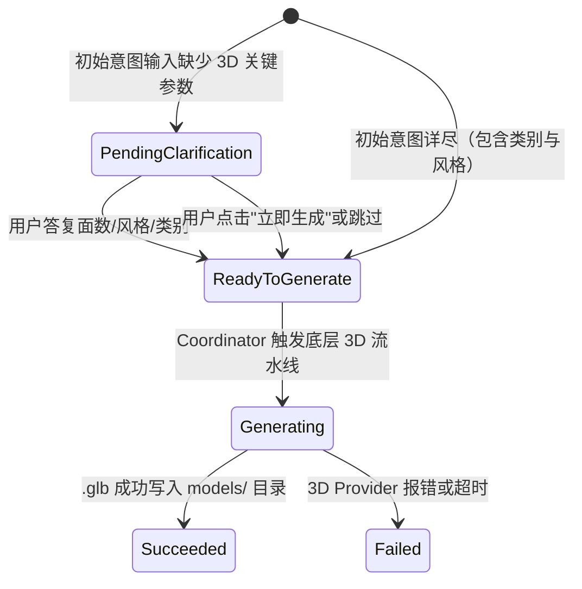

# ThreeDSpecialist Subagent Protocol

**Feature**: 007-3d-model-agent
**Date**: 2026-11-11

---

## 1. 角色定义与能力边界

- **名称**：`ThreeDSpecialist`
- **标识**：`subagent: "model"` 或 `"3d"`
- **职责**：
  - 负责 3D 静态网格模型生成意图的领域级分析；
  - 根据输入自动匹配资产类别（`character` | `prop` | `hard_surface` | `foliage`）；
  - 实施反向拷问（Grill），针对拓扑、面数风格、底座对齐提出专业澄清；
  - 构造符合 3D 扩散/重建模型最优特征的增强型 Prompt；
  - 调用底层 `ThreeDProvider` 执行模型生成与 `.glb` 落盘。

---

## 2. 交互协议与数据结构

### 2.1 结构化输出协议 (`SubagentTurnResult`)

`ThreeDSpecialist` 在执行 `handleTurn` 时返回统一的结构体：

```typescript
export interface SubagentTurnResult {
  readyToGenerate: boolean;
  assistantMessage: string;
  clarifyingQuestions?: string[];
  suggestedPrompt?: string;
  category?: "character" | "prop" | "hard_surface" | "foliage";
  style?: "low-poly" | "pbr" | "stylized";
  assetType?: "model";
}
```

### 2.2 状态流转契约



---

## 3. Coordinator 意图识别集成

在 `lib/agents/coordinator/intent-prompt.ts` 中增强识别规则：
- 当用户输入包含：`3D`、`三维`、`模型`、`mesh`、`glb`、`obj`、`low-poly`、`多边形模型`、`角色建模`、`道具建模` 时，Coordinator 将 `subagent` 判定为 `"model"`。
- 在 `runCoordinatorTurn` 中，当 `subagent === "model"` 或 `"3d"` 时，将任务分发给 `ThreeDSpecialist` 实例。

