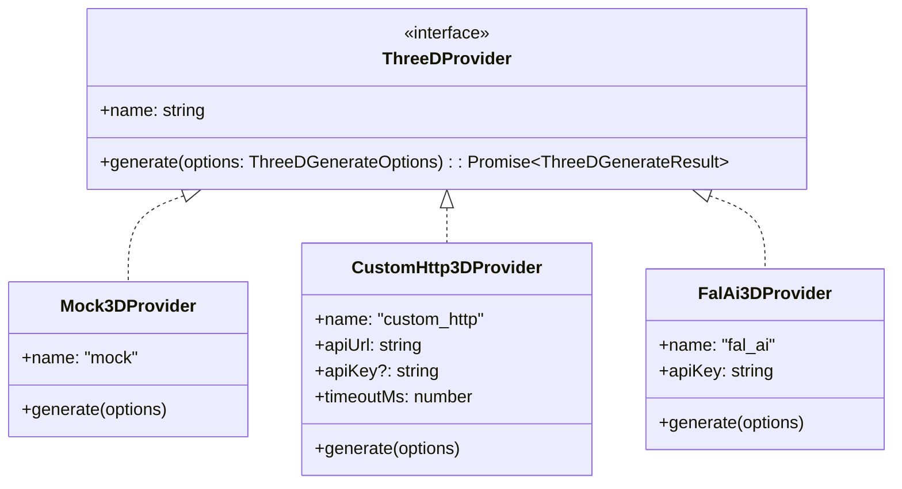

# Phase 0: Technical Research & Feasibility Analysis

**Feature**: 007-3d-model-agent (3D 静态模型生成专有 Agent 与可插拔 Provider 架构)
**Date**: 2026-11-11

---

## 1. 3D 模型格式与规范评估

### 选型：glTF 2.0 Binary (`.glb`)
- **原因**：
  - **单文件自包含**：`.glb` 将 3D 网格、顶点法线、UV 坐标、骨骼、PBR 材质（金属度/粗糙度）和纹理图片全部打包在一个二进制文件中，彻底避免了 `.obj + .mtl + 贴图路径断裂` 的问题。
  - **游戏引擎通用**：Godot 4、Unity、Unreal Engine 5 均对 `.glb` 有原生的拖拽导入支持。
  - **Web 呈现标准**：Google `<model-viewer>`、Three.js、Babylon.js 均以 `.glb` 作为第一公民。
- **文件头校验**：
  - glTF 2.0 二进制文件的前 4 字节为 Magic Number `0x46546C67` (ASCII: `"glTF"`), 第 4-7 字节为 Version (值为 `2`)。
  - 我们将在 Provider 接收与落盘时进行 Magic Number 校验，防止远端返回 404/500 HTML 报错或损坏数据导致存盘。

---

## 2. 3D Specialist 反向拷问（Grill）与资产类别预设 (Category Presets)

在 Feature 006 的多 Agent 架构下，`ThreeDSpecialist` 继承 `BaseSubagent`。不同于图像和 2D 图标，3D 资产具有极其严苛的拓扑、朝向与轴心要求。

### 类别预设设计 (Category Presets)
避免为每一个细分资产类型创建繁琐的 Agent，而是通过类别预设向系统提示词注入几何先验：
1. **`character` (角色/生物)**:
   - 姿态要求：标准 A-Pose 或 T-Pose，双腿微分，双臂下倾 45°。
   - 拓扑要求：水密封闭网格 (Watertight/Manifold)，面向世界坐标 +Z 轴。
2. **`hard_surface` (硬表面/建筑/机械)**:
   - 几何特征：平直边缘、轴对称、机械接缝与倒角 (Bevel)。
3. **`foliage` (植被/植物/树木)**:
   - 材质特征：双面渲染 (Double-sided material)、透明遮罩贴图 (Alpha Cutout)、树干与枝叶分层。
4. **`prop` (通用道具/杂物 - 默认)**:
   - 对齐基准：枢轴点/原点位于底座几何中心 (Pivot at bottom center)，适合直接放置在地面。

### 3D 核心反问维度 (Grill Questions)
1. **面数预算与美术风格**：Low-Poly 低多边形 (Flat-shading)、手绘卡通风格、还是 PBR 真实材质？
2. **对齐与比例**：原点是否位于底座中心？是否有特定的长宽比或体素密度要求？
3. **用途类别**：属于游戏角色立像、场景可交互道具、还是环境植被？

---

## 3. 可插拔 3D Provider 架构设计

### 1. `Mock3DProvider`（默认激活，零成本与测试优先）
- 生成一个符合 glTF 2.0 规范的合规 `.glb` 二进制 Buffer（内置精简合规网格，例如标准 Cube 或箱子资产）。
- 在无任何网络/API Key 配置时，保证全系统、端到端测试以及前端 3D 交互完全可运行。

### 2. `CustomHttp3DProvider`（自建 GPU 实例与合规 HTTP 端点）
- 面向自建 Linux GPU 服务器（如本地 LAN 专用工作站、AutoDL、RunPod 等独立云实例）。
- 协议约定：
  - `POST /generate`
  - Body: `{ prompt: string, category?: string, style?: string, seed?: number, image_url?: string }`
  - Response: 二进制流 (`Content-Type: model/gltf-binary` 或 `application/octet-stream`)，或者 `{ glb_base64: string }` / `{ glb_url: string }`。
  - 超时配置：3D 生成需要 20~60 秒，客户端配置 180s 超时时间。

### 3. `FalAi3DProvider`（可选 Serverless 扩展）
- 对接 `fal.ai/models/fal-ai/trellis`。
- 仅在用户显式配置 `FAL_KEY` 环境变量时启用。

---

## 4. 前端 3D 交互式可视化方案

### 选型：Google `<model-viewer>` Web Component
- **优势**：
  - 零依赖庞大的 Three.js 繁杂代码，打包体积小。
  - 内置完善的相机控制：鼠标左键/单指拖动 360° 旋转、右键/双指平移、滚轮缩放。
  - 内置属性支持：`auto-rotate`、`camera-controls`、`shadow-intensity="1"`、`exposure="1"`。
  - 官方支持 Web Component，浏览器标准规范。
- **React 19 / Next.js SSR 兼容策略**：
  - `<model-viewer>` 依赖浏览器的 `window` 与 `customElements`。
  - 在客户端组件中通过动态加载脚本（或 `next/script`）载入 `@google/model-viewer`。
  - 声明 `declare global { namespace JSX { interface IntrinsicElements { 'model-viewer': ... } } }` 防止 TypeScript 编译报错。

---

## 5. 存储与数据迁移

- 资产类型：扩展 `AssetType` 联合类型新增 `'model'`。
- 存储路径：`data/assets/<convId>/models/<assetId>.glb`。
- 会话类型：`ConversationKind` 增加 `'model'` 选项。
- 任务类型：`SubagentType` 增加 `'model'` 与 `'3d'`。
- 数据库表结构：原 `assets` 表中 `asset_type` 字段为 `TEXT`，可以直接写入 `'model'`，完全兼容已有 SQLite 架构。

